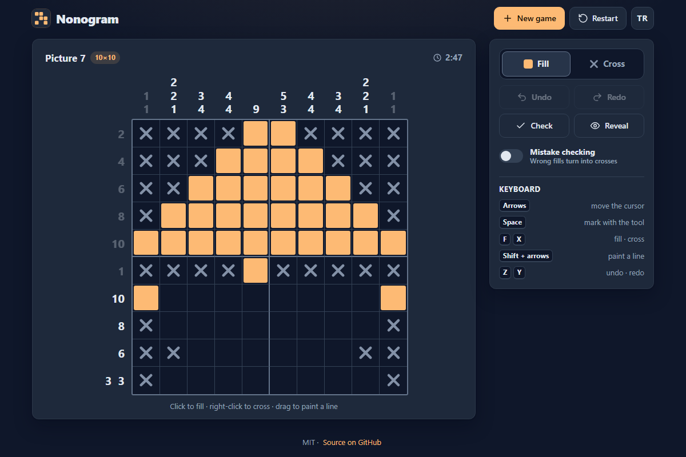

# Nonogram - paint-by-numbers logic puzzles that reveal a hidden picture

[](#tests)
[](LICENSE)

**▶ Play now: https://celaldrg.github.io/nonogram/**



## Features

- **20 hand-made pictures** in 5×5, 10×10 and 15×15. Their names and thumbnails stay hidden until you solve them; then the picture appears in colour with a short animation.
- **Endless random puzzles** in three sizes. Every generated grid has exactly one solution and can be finished by logic alone, so you never have to guess.
- **Fill and cross tools**, drag to paint a straight line, right-click or long-press for a cross.
- **Helpful board**: clues fade once their line is satisfied, and the row and column under the cursor are highlighted.
- **Timer, undo/redo, check and reveal**, plus optional mistake checking that turns wrong fills into crosses and counts them.
- **Best times** (per picture and per random size) **and your progress** are saved in your browser (localStorage). Nothing is sent anywhere.
- **Phone friendly**: the board fits a 375 px screen, and a zoom mode gives 15×15 grids bigger cells with sticky clues and two-finger panning.
- **English and Turkish**, switchable at any time; the choice is remembered.
- Plain HTML, CSS and ES modules: no build step, no dependencies, no network requests. Honours reduced motion.

## How to play

Each number is the length of a run of filled cells in that row or column, in order, with at least one empty cell between runs. Fill the cells so every clue matches and the picture appears. Use crosses to mark cells you know are empty. Open **New game** to pick a picture or a random puzzle.

**Touch**

- Tap a cell to fill it (or cross it with the Cross tool); tap again to clear it.
- Drag to paint a line. The stroke locks to the row or column you start along.
- Long-press a cell to cross it.
- On big grids, tap **Zoom in** and move the board with two fingers.

**Mouse**

- Left-click fills (or crosses with the Cross tool), right-click crosses, click again to clear.
- Drag to paint a line along a row or column.

**Keyboard** (click the board or Tab to it first)

| Key | Action |
| --- | --- |
| Arrow keys | Move the cursor |
| Shift + arrows | Paint a line with the current tool |
| Space / Enter | Mark the cell with the current tool |
| F / X | Fill / cross the cell |
| Z / Y | Undo / redo (Ctrl/Cmd+Z, Ctrl+Shift+Z and Ctrl+Y work too) |

Add `?demo` to the address to open a fixed, half-solved picture (used for the screenshot).

## Run locally

```sh
npx serve .
```

Then open the address it prints (usually http://localhost:3000). The game uses ES modules, so it has to be served over `http://`; opening `index.html` directly from disk (`file://`) does not work. Any static file server will do.

## Tests

```sh
node --test
```

Uses the built-in `node:test` runner (Node 22, no packages). The suites cover clue calculation, the line solver (checked against brute force on 1,500 random lines), the full solver and its uniqueness count, the seeded generator (50 puzzles per size, each with one solution and solvable by line logic), all 20 pictures, the game rules (strokes and line locking, undo/redo, mistake checking, check, win, timer, reveal, restart, saved snapshots), storage fallbacks and saved progress, the English/Turkish string tables, board sizing and the `?demo` state.

## Project structure

```
index.html          page markup
style.css           all styles
src/
  main.js           entry point (reads ?demo)
  app.js            connects game, board, controls and storage
  board-view.js     draws the board and clues
  board-input.js    pointer, touch and keyboard input
  picker.js         "New game" dialog with thumbnails
  dom.js            small DOM helpers
  game.js           game state: strokes, undo/redo, timer, win      (pure)
  clues.js  line-solver.js  solver.js                                 (pure)
  generator.js  rng.js        fair random puzzles from a seeded RNG   (pure)
  puzzles.js  picture-data.js  picture collection and lookup         (pure)
  catalog.js  layout.js  i18n.js  titles, cell sizing, EN/TR text     (pure)
  demo.js  cells.js           ?demo state, cell values                (pure)
  storage.js  progress.js     localStorage wrapper and saved progress
test/               node:test suites
docs/screenshot.png
```

## License

MIT, see [LICENSE](LICENSE).

## Türkçe

Nonogram: sayılara bakarak hücreleri boyadığın ve gizli bir resmi ortaya çıkardığın mantık bulmacası.

**▶ Hemen oyna: https://celaldrg.github.io/nonogram/**

### Özellikler

- **20 el yapımı resim** (5×5, 10×10 ve 15×15). Adları ve küçük resimleri çözene kadar gizli kalır; çözünce resim kısa bir animasyonla renkli olarak belirir.
- **Sonsuz rastgele bulmaca**, üç boyutta. Üretilen her ızgaranın tek bir çözümü vardır ve yalnızca mantıkla bitirilebilir; tahmin gerekmez.
- **Boya ve çarpı araçları**; sürükleyerek düz bir sıra boyama, sağ tık ya da basılı tutarak çarpı.
- **Yardımcı tahta**: satırı tamamlanan ipucu soluklaşır, imlecin altındaki satır ve sütun vurgulanır.
- **Süre, geri al / yinele, denetle ve çözümü aç**; isteğe bağlı hata denetimi yanlış boyamaları çarpıya çevirip sayar.
- **En iyi süreler** (resim başına ve rastgele boyut başına) **ve ilerlemen** tarayıcında (localStorage) saklanır. Hiçbir veri dışarı gönderilmez.
- **Telefona uygun**: tahta 375 px ekrana sığar; yakınlaştırma modu 15×15 ızgarada hücreleri büyütür, ipuçları sabit kalır, iki parmakla kaydırılır.
- **İngilizce ve Türkçe**; dil istenince değişir ve seçim hatırlanır.
- Düz HTML, CSS ve ES modülleri: derleme yok, bağımlılık yok, ağ isteği yok. Azaltılmış hareket ayarına uyar.

### Nasıl oynanır

Her sayı, o satır ya da sütundaki ardışık boyalı hücre grubunun uzunluğudur; gruplar sırayla gelir ve aralarında en az bir boş hücre vardır. Bütün ipuçlarını tutturduğunda resim ortaya çıkar. Boş olduğunu bildiğin hücrelere çarpı koy. Resim ya da rastgele bulmaca seçmek için **Yeni oyun**'a bas.

- **Dokunmatik**: dokunarak boya (Çarpı aracıyla çarpı koy), yeniden dokunarak temizle; sürükleyerek sıra boya (hareket başladığı satır ya da sütuna kilitlenir); basılı tutarak çarpı koy; büyük ızgarada **Yakınlaştır**'a basıp tahtayı iki parmakla kaydır.
- **Fare**: sol tık boyar (Çarpı aracıyla çarpı koyar), sağ tık çarpı koyar, yeniden tıklamak temizler; sürükleyerek sıra boya.
- **Klavye** (önce tahtaya tıkla ya da Tab ile gel): oklar imleci taşır, Shift + oklar seçili araçla sıra boyar, Boşluk / Enter seçili araçla işaretler, F boyar, X çarpı koyar, Z geri alır, Y yineler (Ctrl/Cmd+Z, Ctrl+Shift+Z ve Ctrl+Y de çalışır).

Adresin sonuna `?demo` eklersen yarısı çözülmüş sabit bir resim açılır (ekran görüntüsü için).

### Yerelde çalıştırma

```sh
npx serve .
```

Ardından yazdığı adresi aç (genellikle http://localhost:3000). Oyun ES modülleri kullandığı için `http://` üzerinden sunulmalıdır; `index.html` dosyasını diskten (`file://`) açmak çalışmaz. Herhangi bir statik dosya sunucusu yeterlidir.

### Testler

```sh
node --test
```

Node 22'nin yerleşik `node:test` çalıştırıcısını kullanır, paket gerekmez. Testler ipucu hesabını, satır çözücüyü (1.500 rastgele satırda kaba kuvvetle karşılaştırılır), tam çözücüyü ve tek çözüm sayımını, tohumlu üreticiyi (her boyutta 50 bulmaca; her biri tek çözümlü ve satır mantığıyla çözülebilir), 20 resmin tamamını, oyun kurallarını (sürükleme ve satır kilidi, geri al / yinele, hata denetimi, denetle, kazanma, süre, çözümü aç, sıfırla, kayıtlı durum), depolama yedeklerini ve kayıtlı ilerlemeyi, İngilizce/Türkçe metin tablolarını, tahta boyutlandırmayı ve `?demo` durumunu kapsar.

### Lisans

MIT, ayrıntılar [LICENSE](LICENSE) dosyasında.
